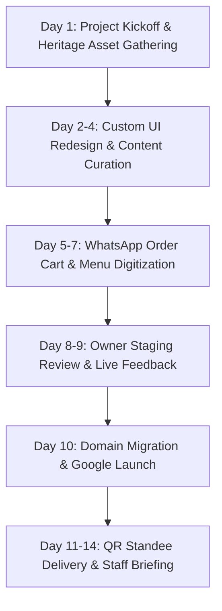

# 🏛️ Digital Heritage Upgrade & Growth Proposal: Tandon's Jalpan
> **"40+ Varshon Ka Vishwas, Ab Modern Digital Andaaz Mein"**  
> *Transforming Patna City's Most Iconic Culinary Legacy (Est. 1981) into a High-Converting Digital Destination*

---

## 1. 📋 Business Executive Profile

| Attribute | Details |
| :--- | :--- |
| **Business Name** | **Tandon's Jalpan** (तंडन जलपान) |
| **Category** | Heritage Sweets, Snacks, Chaat & Casual Multi-Cuisine Dining |
| **Legacy / Established** | **1981** (45+ Years of Culinary Heritage in Patna Sahib) |
| **Physical Address** | Sabzi Bazar, Chowk, Ashok Rajpath Road, Near Nandu Ji Kachori Wale, Hajiganj, Patna, Bihar 800008 |
| **Primary Contact Numbers** | **+91 93343 69201** \| Alternate: **+91 93340 11149** |
| **Customer Reputation** | ⭐ **4.2 – 4.4 / 5.0 Stars** across **1,000+ Google Reviews** *(Highest review volume in Patna City!)* |
| **Existing Web Presence** | `tandononline.com` *(Legacy 2000s-era static website — non-responsive, outdated design, broken modern features)* |
| **Social Media Status** | Facebook Page present (infrequent updates); Instagram presence unoptimized |
| **Flagship Offerings** | Famous Samosas, Signature Gulab Jamun, Malai Rasmalai, Raj Kachori & Chaat counter, Pure Desi Ghee Sweets, North Indian Thalis & Chinese Specialities |
| **Target Digital Goals** | Complete brand modernization, Direct WhatsApp Bulk/Festive Sweet Box Ordering, Corporate Gifting Lead Generation, 0% Commission Direct Delivery Orders |

---

## 2. 🔍 Why Tandon's Jalpan Needs an Urgent Website Redesign
### *The Heritage Disconnect: Real-World Legend vs. Digital Stagnation*

Tandon's Jalpan is not just an eatery; it is a **living institution of Patna City**. Since 1981, three generations of families across Patna Sahib, Ashok Rajpath, Kankarbagh, and Boring Road have celebrated their festivals, weddings, and evening snacks with Tandon's signature samosas and melt-in-the-mouth sweets.

With **over 1,000 verified reviews**, Tandon's commands unmatched social proof. However, when a prospective customer, NRI family visiting Patna Sahib Gurudwara, or a corporate HR manager visits `tandononline.com`, they are greeted by an outdated web layout designed decades ago.

```
+-------------------------------------------------------------------------+
|                        THE DUALITY OF TANDON'S                          |
|                                                                         |
|   OFFLINE REALITY (⭐ 4.4 / 1,000+ Reviews)                            |
|   ✦ 45 Years of Heritage (Est. 1981)                                    |
|   ✦ Massive customer footfall daily on Ashok Rajpath                    |
|   ✦ Unmatched local goodwill & mouth-watering recipes                   |
|                                                                         |
|                                 VS.                                     |
|                                                                         |
|   ONLINE REALITY (tandononline.com)                                     |
|   ✖ Dated non-mobile design reminiscent of 2005                         |
|   ✖ No interactive festival sweet box catalog                           |
|   ✖ No direct 1-click WhatsApp ordering system                          |
|   ✖ 22% - 28% commissions lost on third-party food aggregators          |
+-------------------------------------------------------------------------+
```

### Critical Pain Points Costing Revenue Daily:

1. **Lost Festive Bulk Orders & Corporate Gifting Revenue**  
   During Diwali, Raksha Bandhan, Chhath Puja, Eid, and New Year, companies and institutions across Patna order hundreds of sweet hampers. Today's corporate purchasers and young event organizers search online first. Without a dedicated **Corporate & Festive Gifting Portal**, lucrative bulk orders of 100–500 boxes slip away to modern chains like Harilal's, Bikanervala, or Haldiram's.

2. **The Swiggy & Zomato Commission Trap (20% – 28% Cut)**  
   When regular patrons order their favorite snacks, chaat, or sweets through Swiggy/Zomato, 22% to 28% of your gross billing disappears in commissions, alongside delayed payouts and customer data ownership loss. A direct ordering channel retains **100% of profit margins**.

3. **Mobile-Unfriendly Experience for Younger Patrons & NRIs**  
   Over 88% of local searches in Patna happen on mobile devices. The current `tandononline.com` does not render smoothly on smartphones, making it difficult to read menus, zoom into sweet varieties, or find quick directions.

4. **Patna Sahib Tourist & Pilgrim Traffic Leakage**  
   Located in close proximity to the world-famous Takht Sri Patna Sahib, thousands of national and international pilgrims visit Ashok Rajpath weekly searching for *"Best traditional sweets near Gurudwara"* and *"Famous snacks Patna City"*. An SEO-optimized modern website ensures Tandon's ranks #1 on Google for these high-spending visitors.

---

## 3. 🎨 What We've Already Built: The Interactive Demo Showcase
### *A Preview Tailored Specifically to Tandon's Heritage*

We did not come with an abstract sales pitch; we built a working prototype specifically honoring Tandon's 1981 legacy.

* **Live Demo Path:** [05-tandons-jalpan/index.html](file:///C:/Users/HP/.gemini/antigravity/scratch/patna-business-websites/05-tandons-jalpan/index.html)  
* **Visual Palette:** Regal Burgundy (`#1a0509`), Royal Gold/Marigold (`hsl(38, 100%, 55%)`), and warm cream accents — evoking traditional Indian festivities and premium pure ghee heritage.

```
       ┌─────────────────────────────────────────────────────────┐
       │               TANDON'S JALPAN - DEMO PREVIEW            │
       │    Taste the Heritage of Patna  •  Est. 1981            │
       ├─────────────────────────────────────────────────────────┤
       │ [★ 4.4/5 Rating (1,000+ Reviews)]                       │
       │                                                         │
       │ ✦ Heritage Timeline: 1981 to 2026 Milestone Story      │
       │ ✦ Famous Items Showcase: Samosa, Rasmalai, Gulab Jamun  │
       │ ✦ Filterable Dynamic Menu: Sweets / Snacks / Chaat      │
       │ ✦ 1-Tap Floating WhatsApp Order Engine                  │
       │ ✦ Live Google Maps & Direct Ashok Rajpath Navigation    │
       └─────────────────────────────────────────────────────────┘
```

### Key Elements Built into the Prototype:
* **The 1981 Heritage Banner:** Front-and-center badge highlighting your 45-year status and 1,000+ verified customer reviews.
* **Famous Items Signature Gallery:** Mouth-watering, high-resolution visual displays of your world-class Samosas, Gulab Jamun, Rasmalai, and Chaat.
* **Filterable Menu Architecture:** Seamless tab navigation between *Heritage Sweets*, *Evening Snacks & Chaat*, *North Indian Curries*, and *Chinese Favorites*.
* **WhatsApp Instant Ordering:** Pre-formatted message triggers allowing customers to send their order directly to your counter phone (`+91 93343 69201`) without paying any delivery app commissions.
* **Lightning Fast & Ultra-Responsive:** Optimized for 4G/5G mobile phones on Patna networks, loading in under 1.5 seconds.

---

## 4. 💼 Website Redesign & Subscription Packages

> [!IMPORTANT]
> **Heritage Recommendation:** Because Tandon's Jalpan is one of Patna City's pre-eminent culinary landmarks, a basic 1-page site will not reflect your brand reputation. We strongly recommend the **Premium Heritage Tier** to capture corporate gifting and festive bulk orders.

```
                     ╔═══════════════════════════════════════════════════╗
                     ║              RECOMMENDED SELECTION                ║
                     ║       ⭐ PREMIUM HERITAGE SUITE (₹35,000)        ║
                     ║    Festive Bulk Ordering Engine + Gifting Portal   ║
                     ║     Full Legacy Branding + Advanced Local SEO     ║
                     ╚═══════════════════════════════════════════════════╝
```

---

### Tier 1: Starter Package (₹8,500 – ₹10,000)
*Status: ⚠️ NOT RECOMMENDED for Tandon's Jalpan (Suitable only for brand-new micro-shops)*

* **Scope:** Clean 1-Page Single Scroll Website
* **Focus:** Digital Business Card & Basic Contact Hub
* **What is Included:**
  * Modern single-page responsive layout replacing the old static page
  * Shop history summary & operating hours
  * Static digital menu display (PDF download / photo gallery)
  * Click-to-call button (`+91 93343 69201`)
  * Google Map integration showing Ashok Rajpath location
  * Basic mobile-responsive framework
* **Limitations:** No festive order engine, no corporate gifting portal, no dynamic category filters, basic local SEO only.

---

### Tier 2: Professional Heritage Package (₹18,000 – ₹22,000)
*Status: ✅ Solid Upgrade for General Day-to-Day Operations*

* **Scope:** Multi-Page Custom Website (Up to 5 Dedicated Pages)
* **Focus:** Complete Digital Transformation of `tandononline.com`
* **What is Included:**
  * **Dedicated Multi-Page Structure:** Home, Heritage Story (1981 Legacy), Full Categorized Menu, Famous Items Gallery, Contact & Location
  * **Interactive Digital Menu:** Categorized by Sweets, Chaat, Samosas, Snacks, North Indian, and Chinese with real-time pricing
  * **Interactive Heritage Timeline:** Celebrating 45 years of service in Patna City
  * **Direct WhatsApp Quick-Order System:** Patrons can click "Order via WhatsApp" to instantly message items to counter
  * **Google Business Profile (GMB) Optimization:** Syncing 1,000+ reviews, updating high-res photos, and correcting GPS pins for smooth customer navigation
  * **Mobile-First Speed Optimization:** High performance on all Android & iOS devices
  * **Domain & DNS Migration:** Seamless redirection from existing `tandononline.com` without any downtime
  * **1 Month Dedicated Technical Support & Menu Price Updates**

---

### Tier 3: Premium Heritage & Bulk Order Suite (₹35,000 – ₹45,000)
*Status: 🌟 STRONGLY RECOMMENDED — Custom-Built for Maximum Commercial ROI*

* **Scope:** Comprehensive Enterprise-Grade Heritage Web Portal + Festive Commerce Engine
* **Focus:** Capturing High-Value Corporate Sweet Hampers, Wedding Bulk Gifting, and Slashing Aggregator Commissions
* **What is Included (Everything in Professional PLUS):**
  * **Dedicated Festive Season Bulk Order Portal (Diwali, Chhath, Holi, Rakhi):**
    * Tiered sweet box customizer (e.g., 500g, 1kg, 2kg Premium Dry Fruit & Kaju Katli assortment boxes)
    * Instant bulk discount calculator & inquiry form for corporate HRs and wedding families
  * **Direct WhatsApp Commerce Cart:** Customers select items from the menu, and a formatted invoice bill is generated automatically and sent to your WhatsApp counter number
  * **VIP Corporate Gifting Landing Page:** Tailored for banks, government offices, schools, and businesses in Patna with downloadable brochure catalog
  * **Advanced Local SEO Domination:** Engineered to rank #1 on Google for:
    * *"Best sweets in Patna City"*
    * *"Famous samosa Ashok Rajpath"*
    * *"Diwali sweet gift boxes Patna bulk order"*
    * *"Best Rasmalai & Gulab Jamun in Patna Sahib"*
  * **High-Impact QR Standees (Set of 5 Premium Acrylic Stands):** Placed at dine-in tables and sweet counter for customers to scan, view digital menu, and leave 5-star Google reviews
  * **Customer Data Collection Engine:** Capture birthday/anniversary dates of regular patrons for automated festive SMS/WhatsApp greetings
  * **Visitor Traffic & Order Analytics Dashboard:** Track daily visitors, popular dishes, and peak inquiry hours
  * **2 Months VIP Priority Maintenance & Festive Campaign Setup:** Free menu revisions, festive banner updates (Diwali, Chhath, New Year, Holi), and technical support

---

## 5. 📊 Comprehensive Feature Comparison Matrix

| Feature / Capability | Starter (₹9,000) | Professional (₹20,000) | Premium Heritage (₹35,000) ⭐ |
| :--- | :---: | :---: | :---: |
| **Target Purpose** | Basic Web Presence | Brand Modernization | Revenue & Bulk Growth |
| **Number of Pages** | 1 (Single Page) | 5 Full Pages | Unlimited (Full Portal) |
| **Domain Redirection (`tandononline.com`)** | ✅ Included | ✅ Included | ✅ Included |
| **Mobile & Tablet Responsive Design** | ✅ Standard | ✅ Premium Fluid | ✅ Ultra-Fast VIP Responsive |
| **Heritage Timeline (1981–2026 Story)** | ❌ Basic Text | ✅ Interactive Timeline | ✅ Rich Visual Multimedia Story |
| **Digital Menu Format** | Static PDF / Image | Dynamic Filterable Menu | Dynamic Menu + Cart Engine |
| **Direct WhatsApp Ordering System** | Simple Button | Pre-filled Item Message | Multi-Item Cart & Bill Builder |
| **Festive Bulk Sweet Box Configurator** | ❌ No | ❌ No | ✅ Included (Diwali/Holi/Weddings) |
| **Corporate Gifting Inquiry Engine** | ❌ No | Basic Contact Form | Dedicated B2B Portal + PDF Catalog |
| **Google Review Showcase (1,000+ Reviews)** | Static Stars | Live Widget Embed | Verified Review Showcase & Booster |
| **Local Google SEO Setup** | Basic Tags | Keyword Targeted | Patna-Wide Rank Domination |
| **Acrylic Table/Counter QR Standees** | ❌ None | 2 QR Tent Cards | 5 Premium Acrylic NFC/QR Stands |
| **Social Media Integration (FB/Insta)** | Links Only | Feed Integration | Feed + Share to WhatsApp Triggers |
| **Visitor Analytics & Inquiry Dashboard** | ❌ None | Basic Counter | Real-Time Google Analytics 4 |
| **Festive Banner Updates (Diwali/Chhath)** | ❌ Paid Extra | 1 Festival Included | All Festivals (Full Season Support) |
| **Free Post-Launch Maintenance Support** | 15 Days | 30 Days (1 Month) | 60 Days (2 Months Priority VIP) |

---

## 6. 🎁 Strategic Add-On Services & Growth Infrastructure

Enhance your digital ecosystem with these optional modular additions:

```
+-------------------------------------------------------------------------------+
|                             ADD-ON SERVICE MENU                               |
+-------------------------------------------------------------+-----------------+
| Add-On Item                                                 | Investment (₹)  |
+-------------------------------------------------------------+-----------------+
| 1. High-Speed Cloud Hosting & SSL Certificate (Annual)      | ₹3,500 / year   |
| 2. Google Business Profile 360° Overhaul & Review Booster   | ₹4,500 one-time |
| 3. Professional Sweet & Dish Food Photography (On-Site)     | ₹6,000 / shoot  |
| 4. Extra Custom Acrylic Counter QR Standees (Pack of 5)     | ₹2,000 one-time |
| 5. Festive WhatsApp Marketing Blast Graphic Pack (5 Banners)| ₹3,000 one-time |
| 6. Annual Peace-of-Mind Website Maintenance Contract (AMC)  | ₹9,999 / year   |
+-------------------------------------------------------------+-----------------+
```

* **Domain Note:** Since Tandon's already owns `tandononline.com`, we can either redeploy on this exact domain or assist in acquiring `tandonsjalpan.com` / `tandonsjalpan.in` if desired for clearer brand matching.

---

## 7. 📈 Concrete Return on Investment (ROI) Calculation
### *How the Website Pays for Itself in the First Festive Season*

Many traditional business owners ask: *"Humari dukan toh waise bhi chal rahi hai, website se kitna fayda hoga?"* (Our shop already runs well, how will a website generate extra profit?)

Here is the straightforward mathematics based on **two direct revenue channels**:

---

### Stream A: The Festive Bulk Sweet Box Equation (Diwali & Wedding Season)
During festival seasons in Patna, corporate offices, doctors, traders in Marufganj, and local schools purchase hundreds of gift boxes.

* **Average Cost of a Premium Dry Fruit / Sweets Box:** ₹850
* **Average Corporate Order Size:** 60 Boxes
* **Total Value of a Single Corporate Order:** `60 × ₹850 = ₹51,000`
* **Net Margin for Tandon's (~35%):** **₹17,850 profit per order**

```
   Just TWO (2) Corporate or Wedding Bulk Orders generated through the new 
   Festive Gifting Portal = ₹1,02,000 Gross Sales = ₹35,700 Net Profit!
   
   >>> The Premium Website (₹35,000) completely pays for itself from just TWO orders! <<<
```

---

### Stream B: Swiggy / Zomato Commission Recovery
If Tandon's currently does even ₹5,000 worth of daily orders via third-party delivery apps:
* **Monthly Delivery Billing:** `₹5,000 × 30 days = ₹1,50,000`
* **Aggregator Commission Cut (approx. 24%):** **₹36,000 LOST every single month!**
* **Annual Aggregator Leakage:** **₹4,32,000 per year!**

By placing the table QR standees and counter cards encouraging customers: *"Order directly via WhatsApp for freshest batch & zero delivery markup"*, even converting **25% of existing delivery orders** to direct WhatsApp orders saves:
* **Monthly Savings:** **₹9,000 pure cash back into Tandon's pocket**
* **Annual Direct Savings:** **₹1,08,000 / year**

> [!TIP]
> **Summary:** The website is not an expense — it is an automated sales engine that protects your margins and secures institutional orders that your competitors are currently winning.

---

## 8. 🗓️ 6-Step Implementation Roadmap & Timeline
### *Zero Disruption to Your Daily Counter Sales*

We know how busy the shop gets on Ashok Rajpath. Our development process requires minimal time from your staff.



* **Day 1: Project Kickoff & Menu Finalization**  
  Meeting (or phone sync) to collect updated menu item prices, photos of your famous items (samosas, rasmalai, gulab jamun), and verify the exact domain credentials for `tandononline.com`.
* **Day 2–4: Design Architecture & Heritage Story Crafting**  
  Building the full high-performance framework incorporating Tandon's 1981 legacy, 1,000+ review highlights, and festive sections.
* **Day 5–7: Menu & WhatsApp Engine Integration**  
  Configuring direct WhatsApp routing to `+91 93343 69201` so that any order placed immediately chimes on the counter phone with item names, quantities, and customer details.
* **Day 8–9: Management Staging Review**  
  Private preview link sent to the owner on WhatsApp for review. Adjustments made to prices, descriptions, or imagery.
* **Day 10: Official Go-Live & Domain Switch**  
  Point `tandononline.com` to the brand new modern server with zero downtime. Enable high-security SSL (`https://`).
* **Day 11–14: On-Site QR Setup & Review Optimization**  
  Delivery of physical QR code acrylic counter standees, testing live scan-and-order on your counter phone, and training staff in 15 minutes.

---

## 9. 💳 Transparent Payment Terms & Milestones

We believe in complete transparency and trust, matching the business values of Patna City:

* **Stage 1 (Advance Booking):** **50%** advance upon agreement to initiate design, secure server architecture, and lock development schedule.
* **Stage 2 (Staging Review):** **25%** upon presenting the fully functioning private staging demo for owner approval.
* **Stage 3 (Final Go-Live):** **25%** upon successful public launch on `tandononline.com`, testing WhatsApp ordering, and delivery of physical QR standees.

**Available Payment Modes:**
* UPI (PhonePe / Google Pay / Paytm / BHIM)
* Direct Bank NEFT / RTGS Transfer
* GST Invoice provided for business tax write-off

---

## 10. 📱 Ready-to-Send WhatsApp Communication Templates
### *Crafted for Respectful, Professional Outreach in Patna*

---

### Template 1: Warm Initial Outreach (Acknowledging Legacy)
```text
Pranam Sir 🙏

Mera naam [YOUR NAME] hai. Main Patna City ka local web developer hoon aur bachpan se Tandon's Jalpan ka prasiddh samosa aur gulab jamun ka prashansak raha hoon.

1981 se Tandon's ne Patna City mein jo swaad aur vishwas banaya hai — 1,000 se zyada 4.4★ Google reviews uski gawahi dete hain!

Maine dekha ki aapki website tandononline.com kaafi purani ho chuki hai aur aaj ke smartphones pe sahi se nahi khulti. Is wajah se festive bulk orders aur corporate sweet gift boxes ke bade orders miss ho jate hain.

Humne Tandon's ki 45 saal purani heritage ko dhyan mein rakh kar ek Modern Heritage Demo Website design ki hai jisme:
✨ 1981 Legacy Story & 1,000+ Reviews Showcase
🍬 Famous Sweets & Chaat Photo Gallery
📲 Direct WhatsApp Online Ordering (0% Commission)
🎁 Festive Bulk Sweet Box Order Portal (Diwali/Chhath special)

Aap yahan live demo dekh sakte hain:
👉 [LINK TO DEMO]

Aapko dekh kar kaisa laga, zaroor batayein. Sirf 5 minute ka feedback chahiye tha. Dhanyawad! 🙏
```

---

### Template 2: Follow-Up Focusing on Festive Bulk ROI (2 Days Later)
```text
Namaste Tandon Ji 🙏

Aasha hai aap kushal-mangal honge. 

Pichle message mein maine Tandon's Jalpan ke liye nayi website ka demo bheja tha. Aane wale tyoharon aur lagan ke season mein corporate companies aur families 50-100 sweet boxes ke orders dhoondhti hain.

Agar tandononline.com ko modernize kar diya jaye, toh log direct WhatsApp pe bulk quotation le sakte hain bina Swiggy/Zomato ko 25% commission diye. Sirf 2-3 bulk orders mein website ki poori lagat vasool ho jati hai.

Kya aaj dopahar 3 baje se 5 baje ke beech (non-peak hours) 5 minute ke liye phone par baat ho sakti hai?

Demo Link: [LINK TO DEMO]
Sampark: [YOUR PHONE NUMBER]
```

---

### Template 3: Post-Call Decision Summary (After Phone Discussion)
```text
Pranam Sir 🙏

Aaj phone par baat karke bahut achha laga. Jaisa ki humne discuss kiya, Tandon's Jalpan ke liye humne do best options prepare kiye hain:

1️⃣ Professional Heritage Package (₹20,000)
- 5 Pages Complete Redesign of tandononline.com
- Dynamic Menu with live prices & categories
- Direct WhatsApp Ordering Engine
- Google Reviews Sync & GMB Map Optimization

2️⃣ Premium Heritage & Bulk Order Suite (₹35,000) ⭐ [RECOMMENDED]
- Sabhi Professional features +
- Festive Sweet Box & Corporate Bulk Gifting Portal
- Multi-item WhatsApp Cart Builder (0% commission)
- Advanced SEO: Google pe "Best sweets in Patna" pe #1 rank
- 5 Premium Acrylic QR Standees dukan ke liye
- 2 Mahine ka Festive Banner & Maintenance Support

Hum chahte hain ki Tandon's ka digital presence bhi dukan ki tarah hi shandar ho. Aap bataiye kab se shuru karein? 

Dhanyawad! 🙏
[YOUR NAME] | [YOUR PHONE NUMBER]
```

---

## 11. 🌟 Social Proof & Market Dynamics
### *Why Iconic Heritage Brands Are Digitizing Rapidly*

Throughout India, legendary heritage eateries that modernised their digital touchpoints have seen massive revenue growth while protecting their traditional values:

```
+-------------------------------------------------------------------------------+
|                        HERITAGE SWEET BRANDS EVOLUTION                        |
|                                                                               |
|  Brand                 City       Legacy    Result After Modern Redesign      |
|  --------------------  ---------  -------   --------------------------------  |
|  K.C. Das              Kolkata    1866      340% increase in festive gifting  |
|  Chitale Bandhu        Pune       1950      Direct WhatsApp orders scaled 4x  |
|  Harilal's             Patna      Modern    Dominating Patna online corporate |
|                                             sweet hamper market               |
|                                                                               |
|  TANDON'S JALPAN       Patna      1981      Ready to capture Patna Sahib &    |
|                                             Ashok Rajpath digital leadership! |
+-------------------------------------------------------------------------------+
```

### Market Insights for Patna City (800008):
* **High Gifting Density:** The commercial hub of Chowk, Marufganj, and Sabzi Bazar represents Bihar's largest wholesale trading district. Businessmen exchange high-value sweet boxes throughout the year. A modern portal makes Tandon's their easiest vendor of choice.
* **The Tourist Advantage:** Tourists visiting Patna Sahib Gurudwara look up reviews on Google. A gleaming, fast website converts passersby into high-ticket sweet box shoppers.

---

## 12. ❓ Frequently Asked Questions (FAQ)

#### Q1: "Humari website tandononline.com already chal rahi hai. Nayi kyu banayein?"
**Ans:** Sir, aapki maujuda website 15-20 saal puraani technology par bani hai. Wo mobile par zoom karke padhni padti hai, usme festive box order karne ka koi system nahi hai, aur 0% commission direct ordering nahi hai. Nayi website aapke domain `tandononline.com` par hi chalegi, lekin bilkul naye, tez aur aakarshak roop mein.

#### Q2: "Tyoharon mein mithaai aur dry fruits ke daam badalte hain. Kya menu rates hum badal sakte hain?"
**Ans:** Bilkul! Hum aapko ek behad aasan WhatsApp update system dete hain. Bas ek message bhejiye ya hamari team ko bataiye, 15 minute ke andar naye prices update ho jayenge. Premium plan mein 2 mahine tak yeh service bilkul FREE hai.

#### Q3: "WhatsApp bulk ordering ke liye kya hume computer operator rakhna padega?"
**Ans:** Bilkul nahi! Customer jaise hi website par item ya sweet box chunta hai, uski poori list ek clean message bankar seedhe aapke counter wale mobile (`+91 93343 69201`) ke WhatsApp par aati hai. Jaise normal customer se chat karte hain, waise hi deal confirm ho jati hai.

#### Q4: "Kya humare 1,000+ Google Reviews par koi farq padega?"
**Ans:** Bilkul nahi! Aapki Google profile aur reviews 100% safe rahenge. Balki hum naye website ko aapke Google profile se connect karenge taaki naye customers aakar aur bhi positive reviews de sakein.

#### Q5: "Website banne mein kitna samay lagega aur humara kitna waqt chahiye?"
**Ans:** Poora kaam 7 se 10 dinon mein complete ho jayega. Dukan ke normal kaam-kaaj mein koi disturbance nahi hoga. Humein sirf aapke sath 30-40 minute ki initial sitting chahiye taaki menu aur photos finalize ho sakein.

---

## 13. 🚀 Future Upsell: Augmented Reality (AR) Sweets & 3D Hamper Box Customizer

Once the core website and WhatsApp engine are active, Tandon's can take a quantum leap ahead of every competitor in Bihar with **Next-Gen Food Tech**:

```
+-------------------------------------------------------------------------------+
|                       FUTURE TECH: AR MITHAI EXPERIENCE                       |
|                                                                               |
|  [📱 Customer Smartphone]                                                     |
|            │                                                                  |
|            ▼                                                                  |
|  [Scan QR Code on Table / Flyer]                                              |
|            │                                                                  |
|            ▼                                                                  |
|  [3D AR View on Camera]: Customer sees realistic 3D Festive Sweet Box        |
|  sitting right on their living room table before ordering!                    |
|            │                                                                  |
|            ▼                                                                  |
|  [Customizer]: Choose 4 compartments -> Kaju Katli + Gulab Jamun +            |
|                Motichoor Ladoo + Dry Fruits -> Instant 1-Click WhatsApp Order |
+-------------------------------------------------------------------------------+
```

* **AR Festive Sweet Box Preview:** Customers scan a link and see a 3D simulation of Tandon's signature Royal Sweet Hamper right on their dining table.
* **Interactive "Build Your Own Box" (BYOB):** Corporate clients can drag and drop different sweets to customize their budget box (₹500, ₹800, ₹1200) with automatic weight and cost calculation.
* *This feature can be added as a Phase-2 upgrade before Diwali to establish Tandon's as the most tech-forward heritage brand in Bihar!*

---

## 14. 🤝 Next Steps & Contact Information

We invite the management of Tandon's Jalpan to examine the live demo and take 10 minutes to discuss how this upgrade will elevate the brand's legendary status.

```
+-------------------------------------------------------------------------------+
|                               READY TO PROCEED?                               |
|                                                                               |
|  1. Review the Interactive Demo:                                              |
|     C:\Users\HP\.gemini\antigravity\scratch\patna-business-websites\          |
|     05-tandons-jalpan\index.html                                              |
|                                                                               |
|  2. Schedule a 10-Minute Demonstration at Ashok Rajpath or via Phone:         |
|     Direct Call / WhatsApp: +91 93343 69201 / Management                     |
|                                                                               |
|  3. Milestone 1 Kickoff: We handle photography, domain setup, & launch.      |
+-------------------------------------------------------------------------------+
```

**Created with dedication for Tandon's Jalpan — Preserving Heritage, Powering Growth.**
